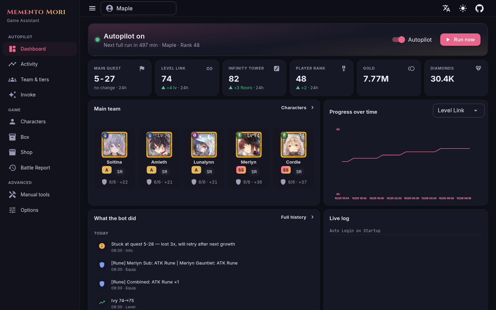
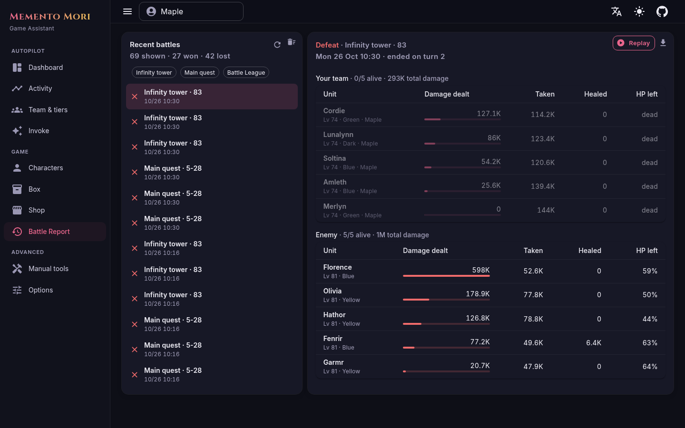
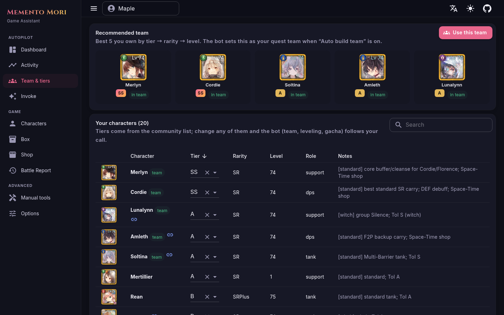
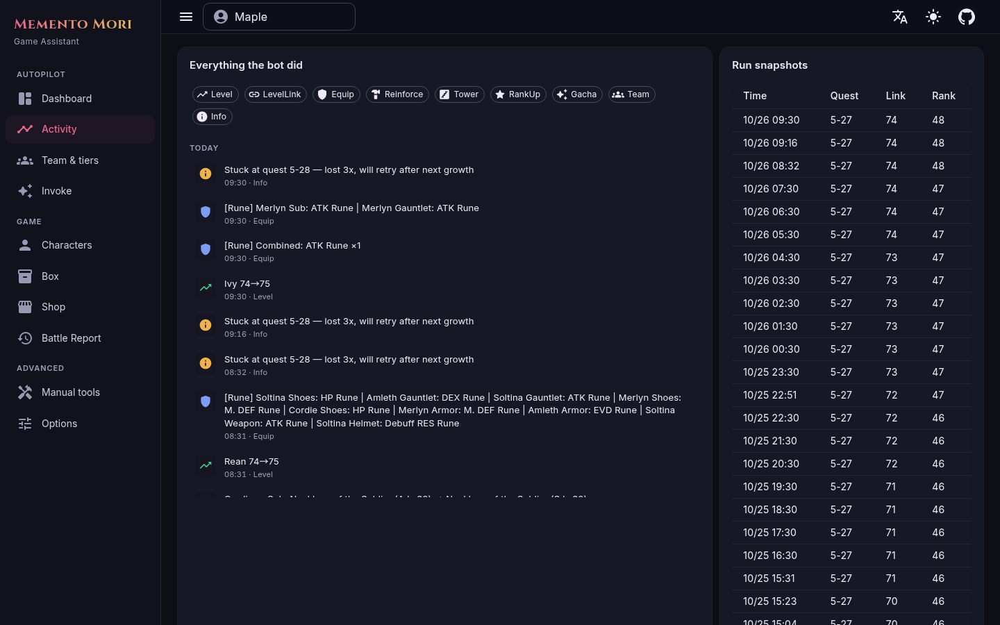

[ [Fork](readme.md) | [Zh](readme.zh.md) | [En](readme.en.md) ]

# MementoMori Helper — Autopilot fork

A fork of [moonheart/mementomori-helper](https://github.com/moonheart/mementomori-helper) that turns the helper into a hands-off **autopilot**: every hour it collects everything, grows your team, pushes the main quest and towers, and tells you what it did.

Upstream docs (setup, every manual feature, FAQ) are still valid: [English](readme.en.md) · [中文](readme.zh.md). Upstream community: [Discord](https://discord.gg/mJ3fWxrypx) · [Telegram](https://t.me/+gTRe8AxKxIdkOTg9).



## What this fork adds

**Autopilot (hourly)**
- Collects login bonus, missions + activity medals, presents, idle rewards, friend points, guild, achievements, character memories (diamonds)
- Fountain of Prayers: dispatch + claim one by one (works before *Claim All* is unlocked)
- Auto team: picks the best 5 by tier → rarity → level and saves it to quest, idle, Infinity tower, Battle League (attack + defense), Temple of Illusions and Cave of Space-Time decks
- Level up, fill Level Link, equip best gear, reinforce team gear
- **Runes**: combines duplicate Lv1–5 runes (only when gold > 1M), opens the first rune slot on team gear, sockets the best runes (no duplicate type per item)
- Main quest + towers until 3 losses in a row; locked elemental towers are skipped
- Smart rank-up (only eats low-tier fodder) and gacha (tickets always, diamonds only on S/SS pickups above a reserve)
- Temple of Illusions: joins a random room, and **hosts its own** if nobody is around for 2 minutes

**UI**
- Dashboard: autopilot status, 24h deltas, progress chart, main team, activity feed, live log
- Activity history and run snapshots
- Team & tiers: built-in community tier list, editable per character, drives every decision above
- Battle log rebuilt: list of every quest / tower / PvP fight, click one to see damage dealt, taken, healed and who died on each side

| Battle log | Team & tiers |
|---|---|
|  |  |



## Run it

Docker is the easiest way (works on arm64 too):

```bash
git clone -b autogrow https://github.com/maplehugs/mementomori-helper
cd mementomori-helper
docker build -t mementomori-webui:custom -f MementoMori.WebUI/Dockerfile .
mkdir -p data && echo '{}' > data/appsettings.user.json
docker run -d --name mementomori -p 127.0.0.1:5290:8080 \
  -v $PWD/data/appsettings.user.json:/app/appsettings.user.json \
  -v $PWD/data/Data:/app/Data -v $PWD/data/BattleLogs:/app/BattleLogs -v $PWD/data/Master:/app/Master \
  mementomori-webui:custom
```

Open `http://127.0.0.1:5290`, go to **Options → Account**, add your Transfer ID + password, and turn on **Autopilot** on the dashboard. Every autopilot feature has its own switch under **Options → Automation**.

Logging into the game yourself kicks the bot's session (and the other way round). That's expected; the next hourly run logs back in.

## Disclaimer — read this before you use it

**This bot breaks MementoMori's Terms of Service. Your account can get banned.**

We build it anyway: automating a game that's designed to make you pay or grind is the whole point, and the ban risk is the price of that. We don't care about the ToS, but we do try to keep you from getting banned. The bot spaces out requests (`AutoRequestDelay`), caps fights per run, stops after a few losses, and only does what a normal F2P player would do by hand. It never spends money and never spends diamonds unless you turn that on.

None of that is a guarantee. If you can't afford to lose the account, don't run it. Use at your own risk. Upstream's [full disclaimer](readme.en.md#disclaimer) applies too.
