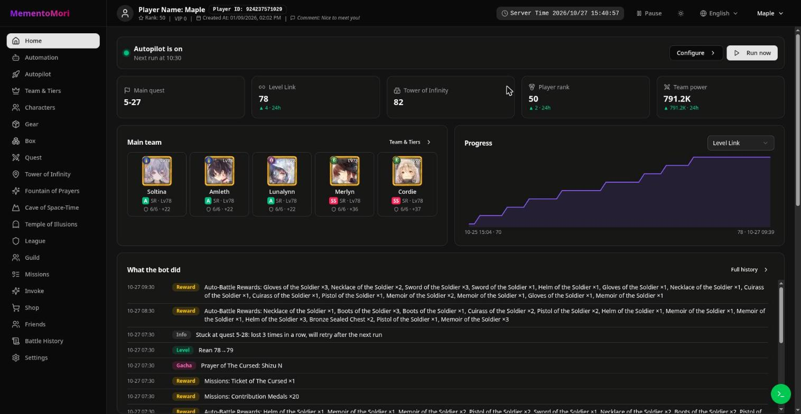
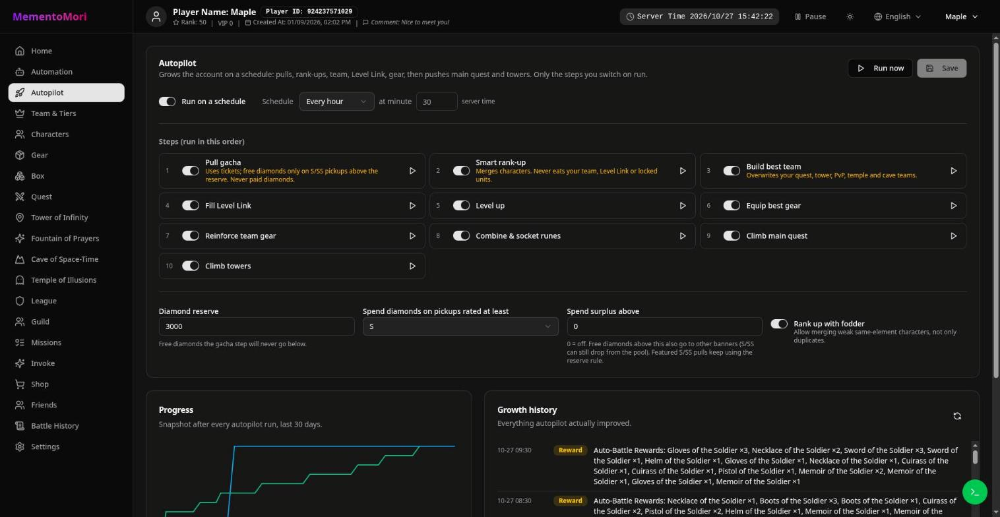
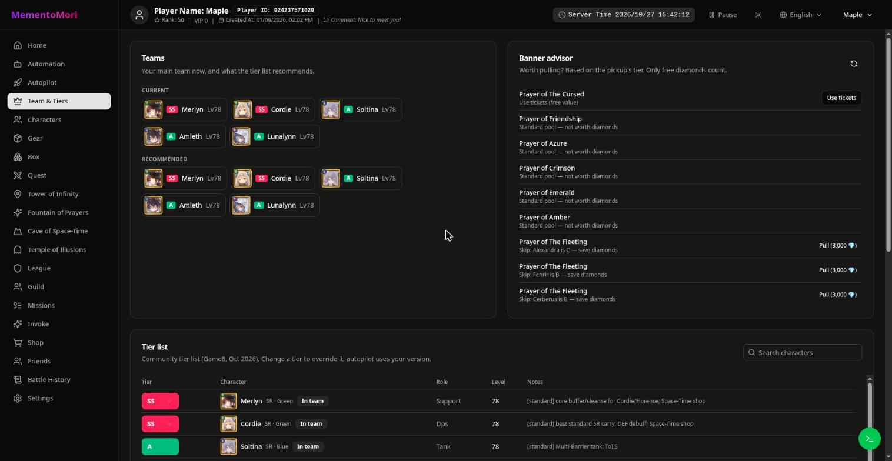
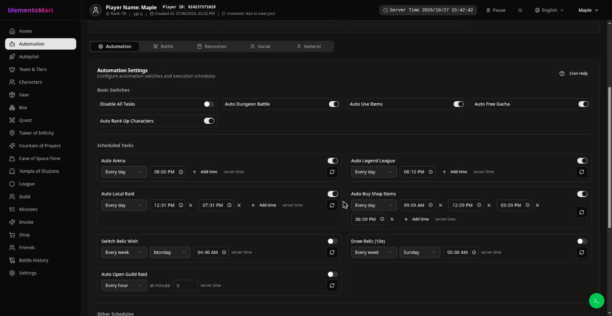

[ [Fork](readme.md) | [Zh](readme.zh.md) | [En](readme.en.md) ]

# MementoMori Helper — Autopilot fork

A fork of [moonheart/mementomori-helper](https://github.com/moonheart/mementomori-helper) that turns the helper into a hands-off **autopilot**: it collects everything, grows your team, pushes the main quest and towers, and shows you what it did.

The new version lives on the [`rewrite`](https://github.com/maplehugs/mementomori-helper/tree/rewrite) branch: moonheart's API + React rewrite with everything from this fork ported into it, proposed upstream in [moonheart#131](https://github.com/moonheart/mementomori-helper/pull/131). The old Blazor version is still on [`autogrow`](https://github.com/maplehugs/mementomori-helper/tree/autogrow).

Upstream community: [Discord](https://discord.gg/mJ3fWxrypx) · [Telegram](https://t.me/+gTRe8AxKxIdkOTg9).



## What it does

**Every day, on its own**
- Login bonuses (including every event / anniversary bonus running at once), VIP gift, monthly pass, presents, achievements
- Missions: daily, weekly, main, guild, and event / collab / comeback / new character / panel missions
- Idle rewards, boss quick battles, Tower of Infinity sweep, Cave of Space-Time, Fountain of Prayers (dispatch + claim)
- Guild check-in, guild raid, guild tower, GvG rewards
- Freebies: character memories (diamonds), friend missions, panel bingo lines, popularity vote, rental raid share rewards, gear synchro missions
- Arena, Legend League, Temple of Illusions and shop purchases on their own schedule

**Autopilot (every hour, each step has its own switch)**
- Gacha: uses every ticket; spends free diamonds only on S/SS pickups and never below your reserve. Paid diamonds are never touched
- Smart rank-up (only eats weak same-element fodder, never your team, Level Link or locked units)
- Builds the best team from the tier list and saves it to quest, idle, towers, Arena, Temple and Cave
- Fills Level Link, levels up, equips the best gear, reinforces it, combines and sockets runes
- Pushes the main quest and towers until 3 losses in a row, then grows again with what it earned

**Things you click yourself** (always behind a confirm that shows the cost): Legend League icon shop, Stars Guidance trade, fountain quick finish, Level Link remove / sort / cooldown reset, manual banner pulls.

| Autopilot | Team & Tiers |
|---|---|
|  |  |

**Also**
- Home: autopilot status, 24-hour changes (quest, Level Link, tower, rank, team power), progress chart, main team, a feed of everything the bot did (levels, gear, pulls, rewards, friends)
- Team & Tiers: your team next to the recommended one, banner advisor, community tier list (Game8, Oct 2026) you can edit per character
- Schedules you set as "every day at 08:00" instead of cron
- **Pause** button for when you play on PC: the bot stops logging in, so it won't kick you
- One account can have characters on several worlds: pick which one the bot plays
- English UI (Chinese, Japanese and Korean too), dark mode, images cached on your server



## Run it

You need Docker. It works on x64 and ARM (Oracle's free A1 servers, Raspberry Pi 4/5).

```bash
git clone -b rewrite https://github.com/maplehugs/mementomori-helper
cd mementomori-helper
docker build -t mementomori-helper -f MementoMori.Api/Dockerfile .
docker run -d --name mementomori --restart unless-stopped \
  -p 127.0.0.1:5290:8080 -v $PWD/data:/data \
  -e Game__AutoRequestDelay=500 \
  mementomori-helper
```

Open `http://127.0.0.1:5290`, click **Add account** and enter the Transfer ID and password from the game (Settings → Account → Transfer). Then turn on **Autopilot** and pick its steps.

Everything (database, game data, image cache) is stored in `./data`. To update: `git pull`, build again and recreate the container.

If you put it on the internet, put a reverse proxy with a password in front of it (Caddy `basic_auth`, nginx `auth_basic`). Anyone who can open the page can play your account.

Logging into the game yourself kicks the bot's session (and the other way round). Hit **Pause** while you play.

## Disclaimer — read this before you use it

**This bot breaks MementoMori's Terms of Service. Your account can get banned.**

We build it anyway: automating a game that's designed to make you pay or grind is the whole point, and the ban risk is the price of that. We don't care about the ToS, but we do try to keep you from getting banned. The bot spaces out requests (`AutoRequestDelay`), caps fights per run, stops after a few losses, and only does what a normal F2P player would do by hand. It never spends money and never spends diamonds unless you turn that on.

None of that is a guarantee. If you can't afford to lose the account, don't run it. Use at your own risk. Upstream's [full disclaimer](readme.en.md#disclaimer) applies too.
